# 📊 Análise de Desempenho - Link Extractor

Este repositório documenta a infraestrutura e os resultados dos testes de carga realizados na aplicação **Link Extractor**, desenvolvido como projeto prático de Ciência da Computação (Computação Distribuída). 

O objetivo é avaliar o comportamento de diferentes tecnologias de backend (Python e Ruby) sob estresse e medir o impacto arquitetural da introdução de uma camada de cache em memória (Redis).

---

## 🛠️ Metodologia de Testes

A infraestrutura foi orquestrada utilizando **Docker Compose** para garantir o isolamento do ambiente. Os testes de carga foram executados com a ferramenta **Locust**.

**Configurações de Carga (Ramp-up progressivo):**
* Carga Leve: 10 usuários (1/s)
* Carga Média: 50 usuários (2/s)
* Carga Máxima: 100 usuários (3/s)

---

## 📊 Visão Geral do Desempenho (100 Usuários)

Para ilustrar o impacto do cache, o gráfico abaixo compara o **Tempo Médio de Resposta** (em milissegundos) dos quatro cenários sob a carga máxima de estresse. O GitHub renderizará este bloco de código automaticamente como um gráfico visual.

```mermaid
gantt
    title Tempo Médio de Resposta (ms) - Carga de 100 Usuários
    dateFormat  X
    axisFormat %s
    section Python
    Com Cache (1202 ms)    : 0, 1202
    Sem Cache (1221 ms)    : 0, 1221
    section Ruby
    Com Cache (1217 ms)    : 0, 1217
    Sem Cache (1215 ms)    : 0, 1215
```

*(Nota: Embora as médias globais sejam próximas, a ausência de cache gerou picos de latência máxima muito superiores durante os momentos de ramp-up, como detalhado abaixo).*

---

## 📈 Resultados Detalhados por Cenário

### Cenário 1: Python COM Cache (Redis)
A API delegou a resposta de consultas repetidas para a memória. O sistema processou mais de 11.500 requisições mantendo o percentil 95% cravado em 1900ms.

| Total de Requisições | Falhas | Mediana (ms) | P95% (ms) | Média (ms) | Máximo (ms) |
| :---: | :---: | :---: | :---: | :---: | :---: |
| 11576 | 0 | 1011.28 | 1900 | 1202.60 | 3361 |

> **Gráficos de Desempenho:**

### Cenário 2: Python SEM Cache
O servidor precisou reprocessar integralmente cada requisição. O esforço computacional extra evidencia a necessidade do cache para evitar a saturação da CPU, resultando num pico máximo de resposta de 3506ms.

| Total de Requisições | Falhas | Mediana (ms) | P95% (ms) | Média (ms) | Máximo (ms) |
| :---: | :---: | :---: | :---: | :---: | :---: |
| 13251 | 0 | 1014.24 | 1900 | 1220.91 | 3506 |

> **Gráficos de Desempenho:**

### Cenário 3: Ruby COM Cache (Redis)
Apresentou o maior volume absoluto de requisições do teste (15365). A mediana e a média indicam um comportamento de vazão altamente previsível, absorvendo de forma eficiente as operações de leitura simultâneas.

| Total de Requisições | Falhas | Mediana (ms) | P95% (ms) | Média (ms) | Máximo (ms) |
| :---: | :---: | :---: | :---: | :---: | :---: |
| 15365 | 0 | 1011.21 | 1900 | 1217.94 | 3499 |

> **Gráficos de Desempenho:**

### Cenário 4: Ruby SEM Cache
O maior pico de latência registrado entre todos os testes ocorreu aqui (3607ms). A ausência do Redis impactou diretamente a estabilidade do sistema para lidar com as rajadas iniciais de tráfego.

| Total de Requisições | Falhas | Mediana (ms) | P95% (ms) | Média (ms) | Máximo (ms) |
| :---: | :---: | :---: | :---: | :---: | :---: |
| 12741 | 0 | 1011.13 | 1900 | 1215.09 | 3607 |

> **Gráficos de Desempenho:**

---

## 📝 Conclusão Analítica

Ambas as tecnologias mantiveram a integridade do sistema, registrando 0% de falhas mesmo sob a carga sustentada de 100 usuários simultâneos. No entanto, a análise dos tempos extremos comprova que o **Redis atua como um escudo computacional fundamental**. Sem ele, os tempos máximos de resposta subiram drasticamente (3506ms no Python e 3607ms no Ruby). O uso da infraestrutura em memória assegura que o sistema distribuído suporte rajadas de acessos sem degradar a experiência do usuário final, independentemente da linguagem de programação adotada pela API.

---
**Autor:** Alípio Fernando Gonçalves Rollo Júnior (Matrícula: 2320422)  
**Curso:** Ciência da Computação